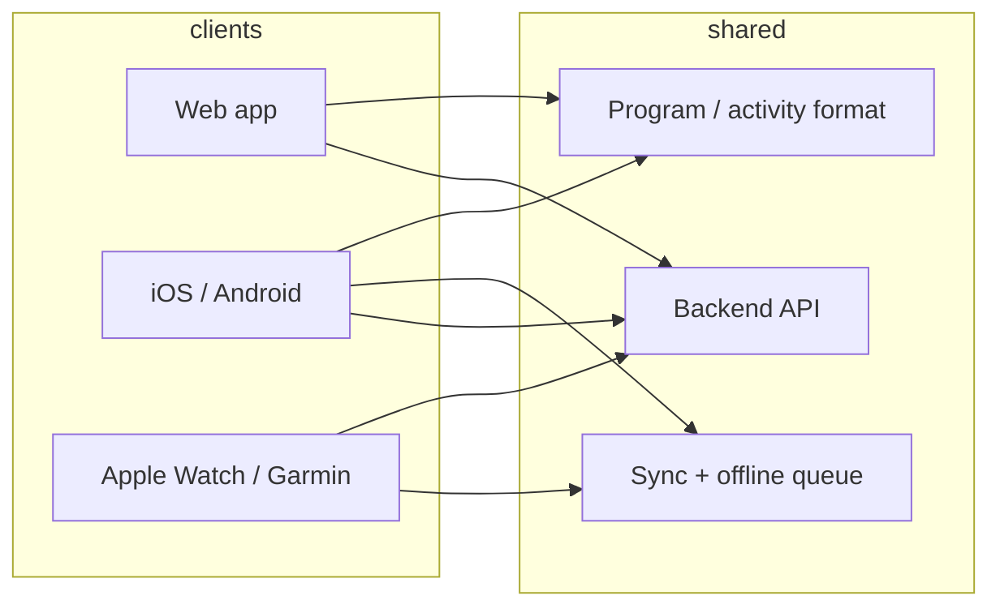
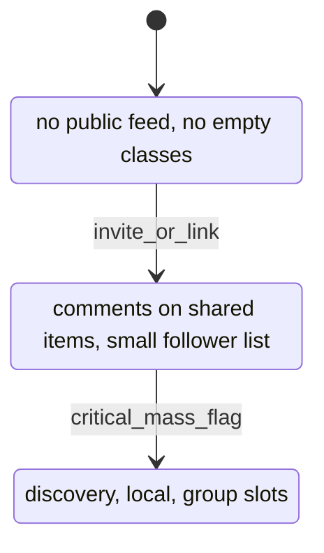
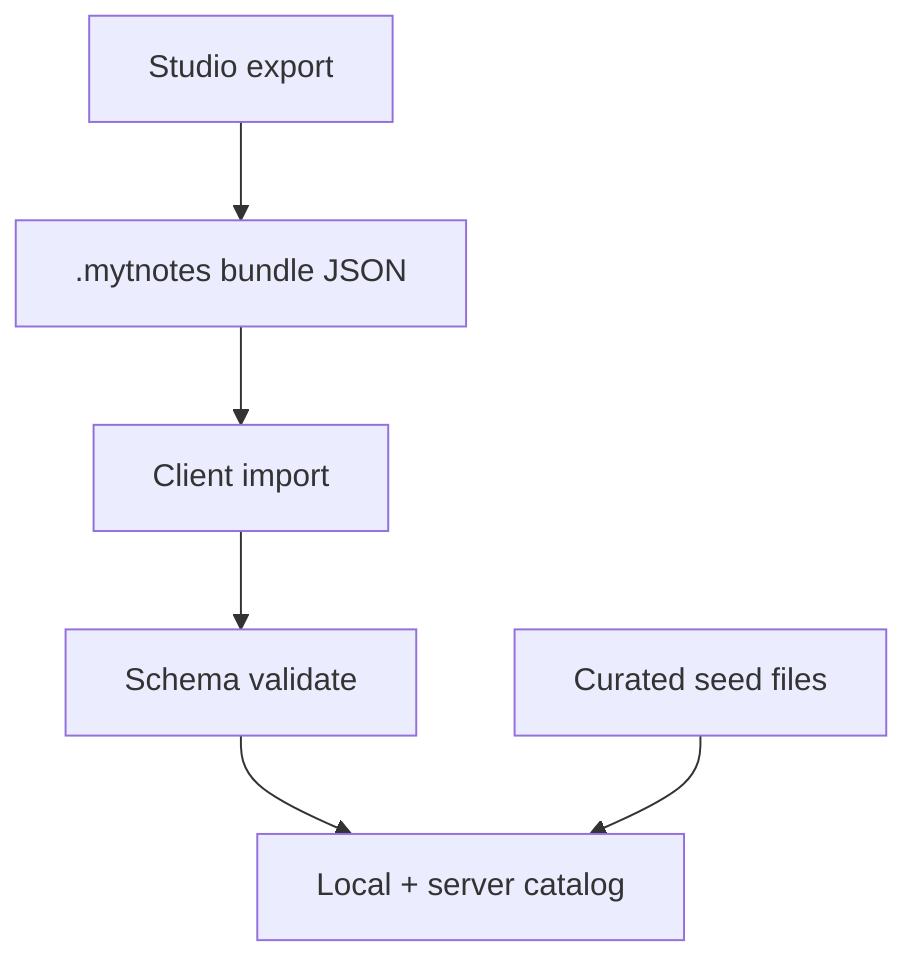

# Design

## Goals

- Single-user experience must feel complete before network effects exist.
- Social surfaces expand in stages; never imply a crowded platform when it is empty.
- Content is portable (import/export) so seed libraries and user sharing do not depend on a live graph.

## Platform strategy



| Option | Pros | Cons |
|--------|------|------|
| **React Native + RN Web** | One UI codebase for phone + web; shared components. | Web polish/SEO/a11y often need extra work; watch is still separate. |
| **Web (React/etc.) + RN mobile** | Best-fit UX per surface; clearer watch companion boundaries. | Two UI codebases; shared packages for models, API client, import/export. |

**Recommendation:** Shared **domain + API client + program file format** in a monorepo; **separate web and mobile UI** unless team size forces RN everywhere. Watches: thin companions (reminders, quick log, coach-call glance) syncing via phone or direct API where platform allows.

## Domain model

```mermaid
erDiagram
  User ||--o{ ProgramSubscription : subscribes
  User ||--o{ ActivityInstance : tracks
  User ||--o{ Reminder : owns
  Program ||--|{ ProgramActivity : contains
  ActivityDefinition ||--o{ ProgramActivity : referenced
  ActivityDefinition ||--o{ ActivityAttachment : has
  ActivityDefinition ||--o{ ActivityVariant : forks
  User ||--o{ ActivityVariant : authors
  ActivityVariant }o--|| ActivityDefinition : based_on
  User ||--o{ Comment : writes
  Comment }o-- ActivityDefinition : on
  Comment }o-- Program : on
  User ||--o{ Achievement : earns

  ActivityAttachment {
    string type "notes|sets|coach|scoring"
    json payload
  }
```

- **ActivityDefinition** — Studio-authored template (attachments + metadata).
- **ActivityVariant** — User fork; listed for adoption with popularity/recency ranking.
- **ActivityInstance** — A user’s active copy (reminders, scoring state, coach-call state).
- **Program** — Ordered list of activity references + program-level metadata.

## Attachment behavior

| Attachment | Stored on | Runtime |
|------------|-----------|---------|
| Notes, Sets, Scoring rules, Coach templates | Definition / variant | Merged when user adopts; user can override locally |
| Reminders | User instance | Never forced from author unless “suggested defaults” |
| Coach call | Template + instance state | Server or client computes phase from user progress/time |

## Social visibility (feature gating)



| Phase | On by default | Hidden or deferred |
|-------|---------------|-------------------|
| Solo | Studio, library, reminders, coach, scoring, import/export | Global feed, group classes, “nearby users” |
| Circle | Share program/activity link, comments among participants, follow ≤ N | Peloton-style slots, leaderboards |
| Platform | Follow graph, adoption rewards surfaced in discovery, scheduled group sessions | — |

Copy and empty states should frame the product as **personal training notes** with optional sharing, not a social network waiting for users.

## Adoption and achievements

- Event: another user adopts an **ActivityVariant** or **Program** authored by user A.
- Idempotent reward rules (first adopter, N adopters, streak while others use your plan).
- Profile shows badges; no requirement to expose total platform adoption counts early.

## Program import / export

**Purpose:** Bootstrap catalog, offline share, backup, creator tooling outside the app.

Suggested properties:

- Versioned schema (e.g. `mytnotes.program.v1`).
- Stable IDs + content hash for dedup when importing into library.
- Optional author attribution block (display name, profile URL) without requiring account on import.
- Activities embedded or referenced by ID if already in catalog.



Ship **seed bundles** with app/web first install; server catalog sync merges without overwriting user edits unless user chooses “replace from source.”

## Initial content

- Vertical slices: **weight loss**, **running**, **strength**, **mobility** (each = program + activities with notes/sets/scoring/coach templates).
- Each activity: at least notes + sets + one scoring objective + optional coach template.
- Variants: 1–2 popular forks per flagship activity to demo adoption UI later (can be same author initially).

## Build strategy (engineering phases)

Align with product roadmap:

| Phase | Build focus |
|-------|-------------|
| **P0** | Schema, API, Studio (minimal), activity instance + reminders + scoring log, web or mobile MVP (pick one primary client). |
| **P1** | Program subscribe/compose, import/export, bundled seed library, coach-call engine (rule-based). |
| **P2** | Variants, adoption events, achievements, share links, comments for invited circle only. |
| **P3** | Follow/discovery, ranking, watch companions, group slots. |

**Single-person perfection (P0–P1):** Reliable reminders, clear daily view, honest progress/scoring, rich default programs — no social dependency.

**Pairs/small groups (P2):** Explicit invite; comments and visibility scoped to shared artifact.

**Platform (P3):** Turn on gated features via remote config when metrics (DAU, shared programs, retention) justify it.

## Open decisions

- Auth: email/passkey vs OAuth only for v1.
- Scoring: manual check-in vs sensor/w HealthKit/Garmin sync.
- Coach call: push vs in-app only on watch.
- Moderation for public variants when Platform phase opens.
